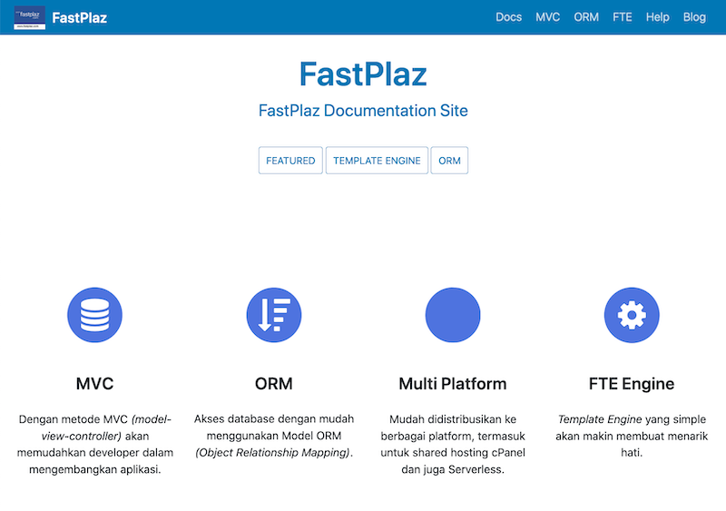

# FastPlaz Docs

Repositori untuk situs [Dokumentasi FastPlaz](https://fastplaz.github.io/) di [fastplaz.github.io](https://fastplaz.github.io/). Dokumentasi ini dibuat dengan menggunakan tools [Docusaurus](https://docusaurus.io).


## Petunjuk

Situs ini menggunakan **Docusaurus v3** dan membutuhkan **Node.js 20 atau lebih baru**.

```bash
$ git clone https://github.com/fastplaz/fastplaz.github.io.git
$ cd fastplaz.github.io/website

# install dependency
$ npm ci

# jalankan server development
$ npm start
```

Browser akan otomatis membuka `http://localhost:3000`.

Atau menggunakan Docker:

```bash
$ docker compose up --build
```

### Struktur

| Path | Isi |
|---|---|
| `website-docs/` | Halaman dokumentasi (Markdown) |
| `website/blog/` | Catatan rilis (Release) |
| `website/sidebars.js` | Susunan menu sidebar dokumentasi |
| `website/src/pages/` | Halaman custom (beranda, help, users) |
| `website/static/` | Gambar dan file statis |
| `website/docusaurus.config.js` | Konfigurasi situs |

### Build & Deploy

```bash
$ npm run build   # hasil di website/build
$ npm run serve   # preview hasil build
```

Deploy berjalan otomatis lewat GitHub Actions (`.github/workflows/deploy.yml`) setiap ada push ke branch `main` di repo `fastplaz/fastplaz.github.io`. Hasil build dipublikasikan ke branch `master`, yang menjadi sumber GitHub Pages.


