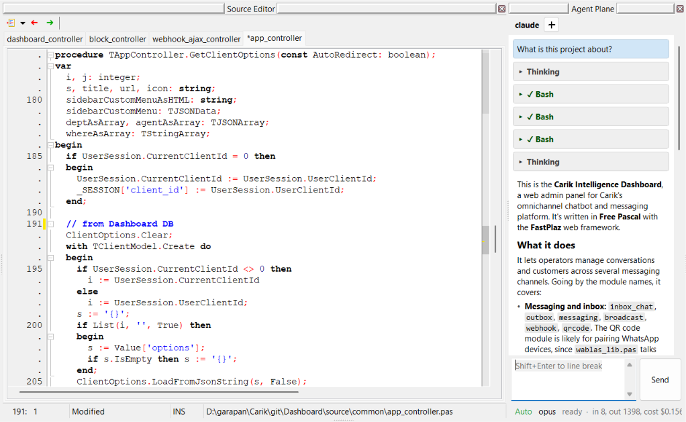

**AI Agent Plane** menghadirkan _coding agent_ langsung di dalam Lazarus IDE. Anda bisa chat dengan Claude Code, OpenCode, Pi, GitHub Copilot CLI, atau agent ACP lainnya di jendela yang bisa di-_dock_. Agent tidak hanya menjawab, tapi juga bisa **memakai IDE itu sendiri**: membuka unit di baris yang tepat, membaca perubahan editor yang belum disimpan, meng-_compile_ project, membaca error compiler lalu memperbaikinya, serta membuat controller dan model FastPlaz.

Fitur ini hadir mulai [rilis 2026 "Hero"](/blog/2026/11/10/release-hero-2026).



## Cara Kerja

```
 Anda ─chat─► Agent Plane ─menjalankan─► Coding agent
              (jendela chat)             (Claude Code, OpenCode,
                                          Pi, Copilot CLI, ACP)
                                                │
                                                │ tool call (MCP)
                                                ▼
 Source Editor ◄─────────────────── MCP server di Lazarus IDE
 (buka, edit, compile)              127.0.0.1:17826/mcp
```

- Jendela chat menjalankan **runtime** (agent) pilihan Anda sebagai proses terpisah. Komunikasi berjalan dalam mode _stream_, sehingga proses berpikir, pemanggilan tool, dan jawaban langsung terlihat.
- Di dalam proses Lazarus IDE berjalan **MCP server** (_Model Context Protocol_) di `http://127.0.0.1:17826/mcp`. Jika port terpakai, server memakai port berikutnya sampai `17835`.
- MCP server **didaftarkan otomatis** ke agent yang dijalankan dari Agent Plane. Anda tidak perlu menyalin endpoint atau token ke konfigurasi agent, dan tidak ada proses _bridge_ terpisah.
- Lewat MCP server ini agent memanggil tool IDE: membuka file, membaca dan mengedit editor, mencari di project, _compile_, serta generator FastPlaz. Daftar lengkapnya ada di [MCP Tools](/docs/ai-agent-plane-mcp).

## Runtime yang Didukung

| Runtime | Cara terhubung |
| --- | --- |
| **Claude Code** | MCP server diberikan lewat `--mcp-config` (file JSON sementara). Tool muncul sebagai `mcp__fastplaz__<tool>`. Pertanyaan Claude Code (`AskUserQuestion`) tampil sebagai kartu pertanyaan di chat. |
| **OpenCode** | Lewat ACP (_Agent Client Protocol_); MCP server dikirim di `session/new`. |
| **Pi** | Mode RPC native. MCP didaftarkan lewat extension sementara (butuh Pi 1.4.0 atau lebih baru). |
| **GitHub Copilot CLI** | Lewat ACP, dengan `--allow-tool=fastplaz` agar Copilot tidak bertanya dua kali. |
| Agent ACP lain | Lewat ACP, jika agent mendukung MCP over HTTP. |

Runtime, model, dan _thinking effort_ bisa diganti langsung dari jendela chat. Model terakhir diingat per runtime.

:::note
Runtime-nya (misalnya `claude`, `opencode`, `pi`, atau `copilot`) harus sudah terpasang dan login di komputer Anda. Agent Plane menjalankan runtime tersebut, bukan menggantikannya.
:::

## Memulai

1. **Pasang package FastPlaz.** Pastikan `tools/fastplaz_tools.lpk` sudah ter-_install_ di Lazarus. Lihat [Instalasi](/docs/installation).
2. **Pilih runtime.** Buka **FastPlaz → Configuration**, tab **AI Harness**. Pilih runtime, model, dan _thinking effort_, lalu klik **Run Test** untuk memeriksa runtime dan MCP server.
3. **Buka Agent Plane.** Pilih menu **FastPlaz → Agent Plane** (letaknya sebelum Database Explorer). Jendela chat bisa di-_dock_ di samping Source Editor.
4. **Mulai chat.** Tuliskan permintaan Anda, misalnya:
   - _"Jelaskan isi project ini."_
   - _"Buat API controller `customer` dengan model untuk tabel `customers`."_
   - _"Compile project dan perbaiki error-nya."_

   Tekan **Shift+Enter** untuk pindah baris, **Enter** atau tombol **Send** untuk mengirim.

## Konfigurasi (tab AI Harness)

Konfigurasi Agent Plane berada satu form dengan Fast Code Configuration, di tab **AI Harness**.

| Pengaturan | Keterangan |
| --- | --- |
| Runtime | Claude Code, OpenCode, Pi, atau GitHub Copilot CLI |
| Model | Daftar model terdeteksi otomatis saat runtime dipilih |
| Thinking effort | `auto`, `off`, `minimal`, `low`, `medium`, `high`, `xhigh` |
| Enable IDE tools (MCP) | `aiplane/mcp_enabled`, default aktif. Jika dimatikan, chat tetap jalan tanpa tool IDE |
| MCP port | `aiplane/mcp_port`, default `17826` (1024–65535) |
| Auto reload | `aiplane/auto_reload`: file yang diubah agent otomatis dimuat ulang di editor tanpa dialog konfirmasi IDE |
| Run Test | Mengecek bahwa runtime bisa dijalankan dan MCP server merespons |

## Anda Tetap Memegang Kendali

Setiap tool MCP punya tingkat izin. Tool yang mengubah file, meng-_compile_, atau menghapus sesuatu menampilkan **permission card** di chat dan menunggu jawaban Anda.

| Tingkat | Perilaku |
| --- | --- |
| auto | Langsung jalan. Hanya untuk tool yang membaca, misalnya `read_editor`, `search_project`, `project_info` |
| ask once per session | Bertanya dulu; pilihan "Allow for this session" diingat sampai sesi di-_reset_. Misalnya `edit_text`, `compile_project`, generator FastPlaz |
| always ask | Selalu bertanya. Untuk tool yang tidak bisa dibatalkan: `revert_file` dan `clean_and_compile_project` |

Permission card menampilkan judul tool, ringkasan apa yang akan terjadi, dan argumennya.

Perubahan dari `edit_text` masuk ke editor sebagai **satu langkah undo**, jadi bisa dibatalkan dengan **Ctrl+Z**. File tidak ditulis ke disk sampai Anda (atau agent, dengan izin) menyimpannya.

## Keamanan

- MCP server hanya mendengarkan di `127.0.0.1`.
- Setiap request wajib membawa `Authorization: Bearer <token>`. Token dibuat acak setiap kali server dimulai, dan tidak pernah ditulis ke konfigurasi agent milik Anda.
- Request dengan header `Origin` yang bukan _loopback_ ditolak (perlindungan DNS rebinding).
- Tool baca hanya membaca file di project dan _search path_-nya. Tool edit hanya mengubah file di direktori project, file project, dan file yang sedang Anda buka; library seperti FastPlaz sendiri tidak ikut diubah. Generator hanya menulis di dalam direktori project.

## Referensi FastPlaz untuk Agent

Agar agent tidak menebak API, MCP server menyediakan referensi FastPlaz sebagai resource `fastplaz://reference` (dan tool `get_fastplaz_reference` untuk agent yang tidak membaca resource). Isinya: struktur project, controller, route, data request dan session, theme dan template tag, `TSimpleModel`, `TJSONUtil`, `config.json`, helper, alur kerja di IDE, serta jebakan umum.

Agent juga diarahkan untuk memakai generator (`create_api_controller`, `create_model`, dll.) daripada menulis controller dan model secara manual.

Teks referensi berasal dari file `tools/templates/agent/fastplaz-reference.md` dan dibaca ulang setiap request, sehingga bisa diubah tanpa _rebuild_ IDE.

## Lihat Juga

- [MCP Tools](/docs/ai-agent-plane-mcp): daftar lengkap 19 tool, argumen, dan izinnya
- [docs/MCP.md](https://github.com/fastplaz/fastplaz/blob/development/docs/MCP.md) di repositori FastPlaz (Bahasa Inggris)
- [Halaman AI Agent Plane](https://www.fastplaz.com/pages/agent-plane/) di fastplaz.com
