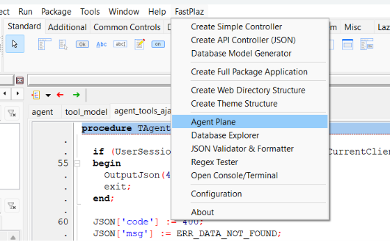
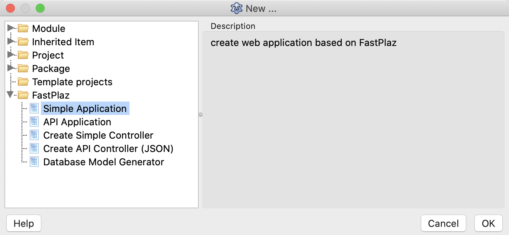

## Prerequisite

* [FPC](https://www.freepascal.org/) / [Free Pascal Compiler](https://www.freepascal.org/), versi 3.2.2
* [Lazarus](https://www.lazarus-ide.org/) (opsional; aplikasi juga bisa di-_compile_ dari terminal)
* [Git Client](https://www.git-scm.com/)
* Web Server (Apache), opsional. Sejak rilis 2026 aplikasi bisa berjalan sebagai [HTTP server standalone](/docs/standalone)
* Database Server (MySQL, PostgreSQL, SQLite, atau Firebird), jika aplikasi menggunakan database

## Persiapan

### Download / Clone

Download atau clone terlebih dahulu repositori ini.

```bash
$ git clone -b development https://github.com/fastplaz/fastplaz.git
```

Disarankan menggunakan cara clone ini dibandingkan dengan download manual. Jika nanti ada update atau perubahan, Anda cukup melakukan `pull` saja.

```bash
$ git reset --hard HEAD
$ git pull
```

Dengan cara ini yang akan diambil hanya perubahannya saja, tidak perlu mengunduh ulang keseluruhan file. Selanjutnya Anda cukup compile ulang saja file-file package-nya.

### Instalasi

Jika Anda adalah pengguna [Lazarus](https://www.lazarus-ide.org/), instalasi untuk penggunaan dasar FastPlaz amat sangat mudah, cukup lakukan langkah ini:

1. Pasang `jcfbase` dan `jcfidelazarus` (Jedi Code Format) dari **Online Package Manager**.
2. Buka file `tools/fastplaz_runtime.lpk`, lalu compile.
3. Buka file `tools/fastplaz_tools.lpk`, lalu compile dan install. Lazarus akan di-_rebuild_.

Hasilnya akan keluar menu **FastPlaz** seperti ini, termasuk [AI Agent Plane](/docs/ai-agent-plane), Database Explorer, dan tool lainnya.



Dan akan terlihat tambahan pilihan baru di menu `File|New Project ...` seperti ini



## Menjalankan Project Pertama

1. Pilih **File → New Project ... → Simple Application** (atau **API Application**).
2. Pilih **Run Mode** HTTP.
3. Jalankan project (**Run → Run** atau F9), lalu buka [http://127.0.0.1:17845](http://127.0.0.1:17845).

Binary yang sama juga bisa berjalan sebagai CGI jika dijalankan oleh Apache. Lihat [Standalone HTTP & CGI](/docs/standalone).

## Konfigurasi Web Server

Bagian ini untuk menjalankan aplikasi sebagai **CGI** di Apache, misalnya di shared hosting. Untuk mode standalone di belakang nginx/Apache, lihat [Standalone HTTP & CGI](/docs/standalone#reverse-proxy).

### CGI dan mod_rewrite

Dalam mode CGI, FastPlaz menggunakan protokol **CGI** dalam menjalankan fungsinya, berati web server yang digunakan pun harus sudah mengaktifkan fitur CGI-nya. Tapi jangan khawatir, distribusi web server Apache pada umumnya sdh aktif CGI-nya.

Agar makin powerfull, FastPlaz sangat menganjur mengaktifkan `Rewrite` di Apache. Untuk mengaktifkan `mod_rewrite` cukup dengan menghilangkan tanda remark di di file `httpd.conf`.
```
#LoadModule request_module modules/mod_request.so
#LoadModule reqtimeout_module modules/mod_reqtimeout.so
LoadModule rewrite_module modules/mod_rewrite.so
#LoadModule sed_module modules/mod_sed.so
#LoadModule session_module modules/mod_session.so
```

### Virtual Host

CGI bisa diaktifkan dengan mengubah isi konfigurasi _virtual host_. Kurang lebih contohnya akan seperti ini:
```bash

<VirtualHost *:80>
    ServerName course.fastplaz.com
    DocumentRoot "D:\course\fastplaz\public_html"
    ErrorLog "logs/course.fastplaz.com-error.log"
    CustomLog "logs/course.fastplaz.com-access.log" common

    <Directory "D:\course\fastplaz\public_html">
        Options +ExecCGI +Indexes
        AddHandler cgi-script .cgi
        AddHandler cgi-script .bin
        AddHandler cgi-script .exe
        Require all granted
        AllowOverride All
    </Directory>
</VirtualHost>
```

Tambahkan `Options +ExecCGI` dan `AddHandler` seperti di atas. Hal yang sama untuk pemakai Apache di Linux atau Mac, hanya berbeda di penamaan path Directory dan DocumentRoot saja.
