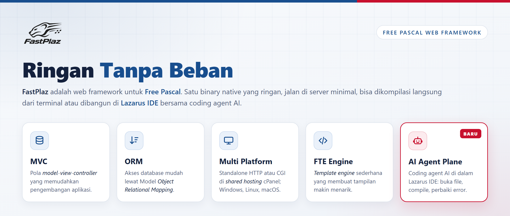

FastPlaz rilis 2026 dengan kode **"Hero"** hadir dengan dua fitur besar: aplikasi yang sama bisa berjalan sebagai **HTTP server standalone** maupun **CGI**, dan **AI Agent Plane**, coding agent langsung di dalam Lazarus IDE.

<!--truncate-->

Rilis ini juga hasil review menyeluruh terhadap seluruh unit di `FastPlaz/src` dan `tools/src`: sekitar 170 commit, 365 file, +51.000 / −11.900 baris, dengan unit test untuk setiap library.

## Headline

1. **Satu binary, dua mode: Standalone HTTP dan CGI.** Aplikasi FastPlaz bisa jalan sebagai web server sendiri atau tetap sebagai CGI di Apache/nginx, tanpa ganti kode. [Selengkapnya](/docs/standalone)
2. **AI Agent Plane.** Claude Code, OpenCode, Pi, GitHub Copilot CLI, dan agent ACP lain langsung di dalam Lazarus IDE, lengkap dengan MCP server yang bisa membuka file, mengedit, _compile_, dan membuat controller/model FastPlaz. [Selengkapnya](/docs/ai-agent-plane)
3. **Review dan perbaikan menyeluruh.** Memory leak, double free, celah keamanan, dan bug lama diperbaiki.
4. **Lebih aman secara default.** CSRF per form, cookie session HttpOnly/SameSite/Secure, CSPRNG, perlindungan XXE, SQL yang di-_quote_, header injection ditutup.
5. **Lintas platform yang benar-benar dites.** Lebih dari 700 unit test FPCUnit, dijalankan di Windows dan Linux.

## Fitur Baru

### Standalone HTTP mode

- Unit baru `fastplaz_app` menggantikan `fpcgi`. Mode dipilih otomatis: `--mode=cgi|http`, variabel `GATEWAY_INTERFACE`, atau `systems/server/mode` di `config.json`.
- Default `http://127.0.0.1:17845`.
- Graceful shutdown (Ctrl+C / SIGTERM), `max_requests`, koneksi database per request.
- Dukungan `X-Forwarded-*` di belakang reverse proxy tepercaya.
- Wizard project (Simple, API, Full Package) punya pilihan Run Mode HTTP/CGI.

### AI Agent Plane

- Jendela chat yang bisa di-_dock_ di menu **FastPlaz → Agent Plane**: jawaban markdown, code block dengan syntax highlighting, permission card, dan kartu pertanyaan.
- Ganti runtime, model, dan effort langsung dari chat.
- File yang diubah agent otomatis dimuat ulang di editor.
- MCP server bawaan (`127.0.0.1:17826`) dengan [19 tool](/docs/ai-agent-plane-mcp): editor, pencarian, _compile_ dan build, generator controller/model, serta referensi FastPlaz untuk agent.

### Library

- **SMTP client bawaan** (`smtp_lib`): `TMailer` bisa mengirim email tanpa Synapse.
- **Database**: `ExecScript` / `ExecSQLScript`, `QuoteIdentifier`, `QuoteValue`, `SoftDelete` yang benar-benar berfungsi.
- **Theme**: filter `escape`, `[if]` ditulis ulang (operator perbandingan, nesting), `[foreach]` bersarang.
- **Session**: `RegenerateID`, cookie HttpOnly/SameSite/Secure.
- **Redis**: IPv6, parsing RESP lengkap, connect timeout.

### IDE Tools

- Fast Code mendukung server yang kompatibel dengan OpenAI.
- Database Explorer: default MySQL 8.0, toolbar ikon, lebar kolom otomatis.
- Menu **FastPlaz → Open Console/Terminal** dan shortcut keyboard untuk menu FastPlaz.
- Terjemahan Bahasa Indonesia untuk IDE tools.

## Sebelum Upgrade

Beberapa perbaikan bisa mengubah perilaku aplikasi yang sudah ada, misalnya `Redirect`/`die` yang tidak lagi keluar dari method, session timeout dalam menit, dan `Save`/`Delete` yang mengembalikan `False`. Baca [Upgrade ke Rilis 2026](/docs/upgrade) terlebih dahulu.

Repository: [github.com/fastplaz/fastplaz](https://github.com/fastplaz/fastplaz) · Brief lengkap: [RELEASE-2026-Hero.md](https://github.com/fastplaz/fastplaz/blob/development/docs/RELEASE-2026-Hero.md)
