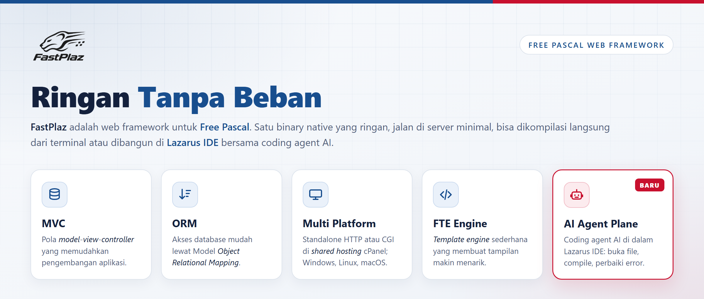

The 2026 FastPlaz release, code name **"Hero"**, brings two major features: the same application can run as a **standalone HTTP server** or as **CGI**, and **AI Agent Plane**, a coding agent right inside the Lazarus IDE.

<!--truncate-->

This release is also the result of a thorough review of every unit in `FastPlaz/src` and `tools/src`: about 170 commits, 365 files, +51,000 / −11,900 lines, with unit tests for every library.

## Headline

1. **One binary, two modes: Standalone HTTP and CGI.** A FastPlaz application can run as its own web server or still as CGI under Apache/nginx, with no code changes. [Read more](/docs/standalone)
2. **AI Agent Plane.** Claude Code, OpenCode, Pi, GitHub Copilot CLI, and other ACP agents right inside the Lazarus IDE, complete with an MCP server that can open files, edit, _compile_, and create FastPlaz controllers/models. [Read more](/docs/ai-agent-plane)
3. **Thorough review and fixes.** Memory leaks, double frees, security holes, and long-standing bugs have been fixed.
4. **More secure by default.** Per-form CSRF, HttpOnly/SameSite/Secure session cookies, CSPRNG, XXE protection, _quoted_ SQL, header injection closed.
5. **Cross-platform, actually tested.** More than 700 FPCUnit unit tests, run on Windows and Linux.

## New Features

### Standalone HTTP mode

- The new `fastplaz_app` unit replaces `fpcgi`. The mode is selected automatically: `--mode=cgi|http`, the `GATEWAY_INTERFACE` variable, or `systems/server/mode` in `config.json`.
- Default `http://127.0.0.1:17845`.
- Graceful shutdown (Ctrl+C / SIGTERM), `max_requests`, per-request database connections.
- `X-Forwarded-*` support behind a trusted reverse proxy.
- The project wizards (Simple, API, Full Package) have an HTTP/CGI Run Mode option.

### AI Agent Plane

- A _dockable_ chat window under the **FastPlaz → Agent Plane** menu: markdown answers, code blocks with syntax highlighting, permission cards, and question cards.
- Switch runtime, model, and effort right from the chat.
- Files changed by the agent are automatically reloaded in the editor.
- Built-in MCP server (`127.0.0.1:17826`) with [19 tools](/docs/ai-agent-plane-mcp): editor, search, _compile_ and build, controller/model generators, and FastPlaz reference for the agent.

### Library

- **Built-in SMTP client** (`smtp_lib`): `TMailer` can send email without Synapse.
- **Database**: `ExecScript` / `ExecSQLScript`, `QuoteIdentifier`, `QuoteValue`, and a `SoftDelete` that actually works.
- **Theme**: `escape` filter, rewritten `[if]` (comparison operators, nesting), nested `[foreach]`.
- **Session**: `RegenerateID`, HttpOnly/SameSite/Secure cookies.
- **Redis**: IPv6, full RESP parsing, connect timeout.

### IDE Tools

- Fast Code supports OpenAI-compatible servers.
- Database Explorer: MySQL 8.0 by default, icon toolbar, automatic column width.
- **FastPlaz → Open Console/Terminal** menu and keyboard shortcuts for the FastPlaz menu.
- Indonesian translation for the IDE tools.

## Before Upgrading

Some fixes may change the behavior of existing applications, for example `Redirect`/`die` no longer exit the method, session timeout is in minutes, and `Save`/`Delete` return `False`. Read [Upgrading to the 2026 Release](/docs/upgrade) first.

Repository: [github.com/fastplaz/fastplaz](https://github.com/fastplaz/fastplaz) · Full brief: [RELEASE-2026-Hero.md](https://github.com/fastplaz/fastplaz/blob/development/docs/RELEASE-2026-Hero.md)
