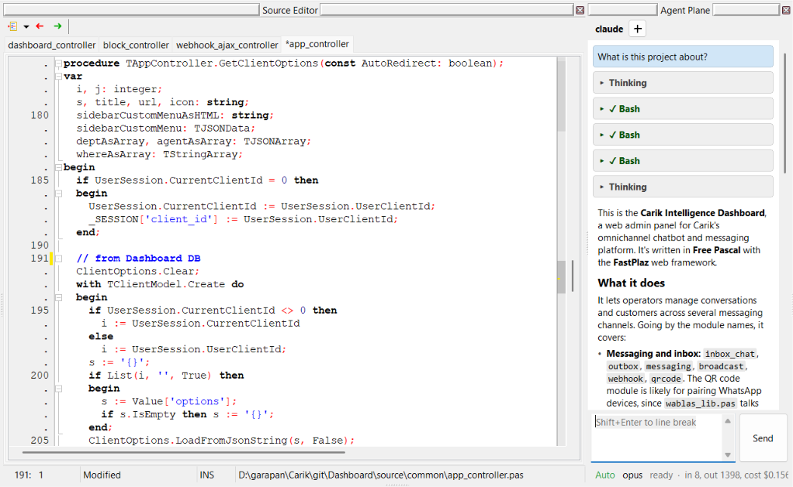

**AI Agent Plane** brings a coding agent right into the Lazarus IDE. You can chat with Claude Code, OpenCode, Pi, GitHub Copilot CLI, or another ACP agent in a dockable window. The agent does more than answer: it can **use the IDE itself**. It opens a unit at the right line, reads unsaved editor changes, compiles the project, reads the compiler errors and fixes them, and creates FastPlaz controllers and models.

This feature is available from the [2026 "Hero" release](/blog/2026/11/10/release-hero-2026).



## How It Works

```
 You ──chat──► Agent Plane ──runs──► Coding agent
               (chat window)         (Claude Code, OpenCode,
                                      Pi, Copilot CLI, ACP)
                                            │
                                            │ tool call (MCP)
                                            ▼
 Source Editor ◄─────────────── MCP server in Lazarus IDE
 (open, edit, compile)          127.0.0.1:17826/mcp
```

- The chat window runs the **runtime** (agent) you choose as a separate process. Communication is streamed, so thinking, tool calls, and answers show up as they happen.
- An **MCP server** (Model Context Protocol) runs inside the Lazarus IDE process at `http://127.0.0.1:17826/mcp`. If the port is taken, the server uses the next port, up to `17835`.
- The MCP server is **registered automatically** with the agent started from Agent Plane. You do not need to copy the endpoint or token into the agent configuration, and there is no separate bridge process.
- Through this MCP server the agent calls IDE tools: opening files, reading and editing the editor, searching the project, compiling, and the FastPlaz generators. The full list is in [MCP Tools](/docs/ai-agent-plane-mcp).

## Supported Runtimes

| Runtime | How it connects |
| --- | --- |
| **Claude Code** | The MCP server is passed through `--mcp-config` (a temporary JSON file). Tools appear as `mcp__fastplaz__<tool>`. Claude Code questions (`AskUserQuestion`) are shown as question cards in the chat. |
| **OpenCode** | Through ACP (Agent Client Protocol); the MCP server is sent in `session/new`. |
| **Pi** | Native RPC mode. MCP is registered through a temporary extension (needs Pi 1.4.0 or later). |
| **GitHub Copilot CLI** | Through ACP, with `--allow-tool=fastplaz` so Copilot does not ask a second time. |
| Other ACP agents | Through ACP, if the agent supports MCP over HTTP. |

Runtime, model, and thinking effort can be changed directly from the chat window. The last model used is remembered per runtime.

:::note
The runtime (for example `claude`, `opencode`, `pi`, or `copilot`) must already be installed and logged in on your computer. Agent Plane runs that runtime; it does not replace it.
:::

## Getting Started

1. **Install the FastPlaz package.** Make sure `tools/fastplaz_tools.lpk` is installed in Lazarus. See [Installation](/docs/installation).
2. **Choose a runtime.** Open **FastPlaz → Configuration**, tab **AI Harness**. Choose the runtime, model, and thinking effort, then click **Run Test** to check the runtime and the MCP server.
3. **Open Agent Plane.** Choose **FastPlaz → Agent Plane** (just above Database Explorer). The chat window can be docked next to the Source Editor.
4. **Start chatting.** Type your request, for example:
   - _"Explain what this project does."_
   - _"Create an API controller `customer` with a model for the `customers` table."_
   - _"Compile the project and fix the errors."_

   Press **Shift+Enter** for a new line, **Enter** or the **Send** button to send.

## Configuration (AI Harness Tab)

Agent Plane settings are in the same form as Fast Code Configuration, on the **AI Harness** tab.

| Setting | Description |
| --- | --- |
| Runtime | Claude Code, OpenCode, Pi, or GitHub Copilot CLI |
| Model | The model list is detected automatically when a runtime is selected |
| Thinking effort | `auto`, `off`, `minimal`, `low`, `medium`, `high`, `xhigh` |
| Enable IDE tools (MCP) | `aiplane/mcp_enabled`, on by default. When off, the chat still works without IDE tools |
| MCP port | `aiplane/mcp_port`, default `17826` (1024–65535) |
| Auto reload | `aiplane/auto_reload`: files changed by the agent are reloaded in the editor automatically, without the IDE confirmation dialog |
| Run Test | Checks that the runtime can be started and the MCP server responds |

## You Stay in Control

Every MCP tool has a permission level. Tools that change files, compile, or delete something show a **permission card** in the chat and wait for your answer.

| Level | Behavior |
| --- | --- |
| auto | Runs right away. Only for tools that read, for example `read_editor`, `search_project`, `project_info` |
| ask once per session | Asks first; "Allow for this session" is remembered until the session is reset. For example `edit_text`, `compile_project`, the FastPlaz generators |
| always ask | Always asks. For tools that cannot be undone: `revert_file` and `clean_and_compile_project` |

The permission card shows the tool title, a summary of what will happen, and its arguments.

Changes from `edit_text` go into the editor as **a single undo step**, so they can be undone with **Ctrl+Z**. The file is not written to disk until you (or the agent, with permission) save it.

## Security

- The MCP server listens on `127.0.0.1` only.
- Every request must carry `Authorization: Bearer <token>`. A random token is made each time the server starts, and it is never written into your own agent configuration.
- Requests with a non-loopback `Origin` header are refused (DNS rebinding protection).
- Read tools only read files in the project and its search paths. Edit tools only change files in the project directory, project files, and files you have open; libraries such as FastPlaz itself are not changed. Generators only write inside the project directory.

## FastPlaz Reference for Agents

So the agent does not guess the API, the MCP server provides a FastPlaz reference as the resource `fastplaz://reference` (and the tool `get_fastplaz_reference` for agents that do not read resources). It covers project layout, controllers, routes, request and session data, themes and template tags, `TSimpleModel`, `TJSONUtil`, `config.json`, helpers, the workflow in the IDE, and common pitfalls.

The agent is also told to use the generators (`create_api_controller`, `create_model`, etc.) instead of writing controllers and models by hand.

The reference text comes from the file `tools/templates/agent/fastplaz-reference.md` and is read again on every request, so it can be edited without rebuilding the IDE.

## See Also

- [MCP Tools](/docs/ai-agent-plane-mcp): the full list of 19 tools, their arguments, and permissions
- [docs/MCP.md](https://github.com/fastplaz/fastplaz/blob/development/docs/MCP.md) in the FastPlaz repository
- [AI Agent Plane page](https://www.fastplaz.com/pages/agent-plane/) on fastplaz.com
