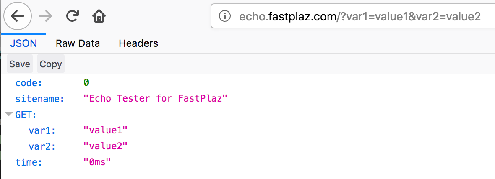

Building an API? It's easy.

A wizard is available in the `File|New|FastPlaz|API Application...` menu. 

This example echoes back (_echo_) all parameters, both GET and POST, sent to this API _endpoint_.

It also includes `tools` for those who want to use [Docker](https://www.docker.com/), as well as a `builder` for deploying to a _serverless_ platform. You can try it on Amazon Lambda.

## Source Code

The **Echo Example** is available in the FastPlaz repository at [github.com/fastplaz/echo](https://github.com/fastplaz/echo). _Git clone_ it, then compile.

## Topics

From this example you can learn about:

- Building a simple API.
- JSON, both reading JSON data and producing JSON-formatted output.
- RAW BODY input.
- Reading parameters via the GET and POST methods.
- Introduction to Docker.
- Introduction to Serverless (Amazon Lambda).

### Docker

A tutorial on how to _build_ this Echo API with Docker is available on [Luri Darmawan's Medium channel](https://medium.com/@luridarmawan/build-fastplaz-echo-project-with-docker-1271aea5f04d)

### Serverless

//TODO: serverless tutorial
