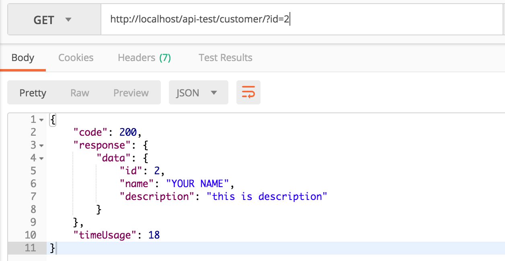

Building an API? It's easy.

A wizard is available in the `File|New|FastPlaz|API Application...` menu.

This source code is a simple example of a REST (API) implementation using [FastPlaz](https://fastplaz.com), without permission checks or input validation. The example shows how to read, add, update and delete _customer_ data over the REST protocol.

This example has been tested on Linux and Mac. Windows users may need to make adjustments, especially for path/folder/directory names.

| End point | Method | Description |
|---|---|---|
| /customer | Post | Add a customer |
| /customer | Get | List customers. Available parameters: - limit - offset |
| /customer/{id}/ | Get | Show a specific customer by its `id`. |
| /customer/{id}/profile | Get | Show detailed data (_customer profile_) |
| /customer/{id}/ | Put | Update the entire customer profile |
| /customer/{id}/ | Patch | Update part of the customer profile |
| /customer/{id}/ | Delete | Delete a customer |

## Source Code

The **REST API Example** is available in the FastPlaz repository at [github.com/fastplaz/example-rest](https://github.com/fastplaz/example-rest). _Git clone_ it, then compile. Follow the steps in the _readme_.

## Topics

From this example you can learn about:

- Building a simple API.
- REST Protocol
- JSON, both reading JSON data and producing JSON-formatted output.
- Reading parameters via the GET and POST methods.
- Routing with _regex patterns_.
- Database with [ORM](/docs/orm) [Model](/docs/usage-model)
- Automation Test

## References

- [Understanding REST](https://github.com/fastplaz/fastplaz/blob/development/REST.md)

> Note: Turn off debug mode (Log) when used on a production server.

