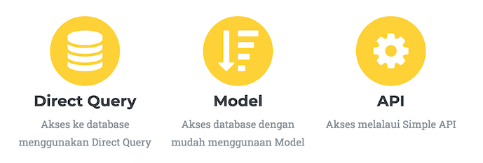
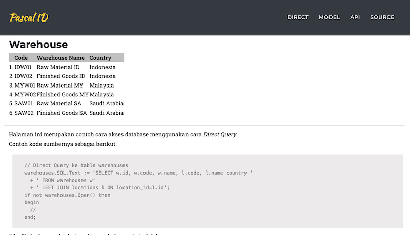
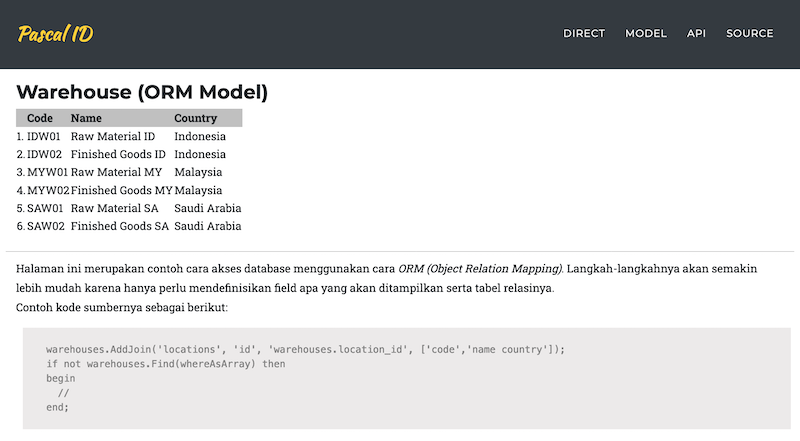
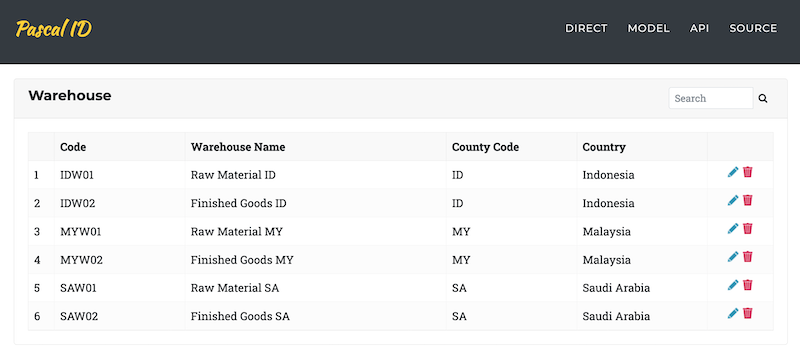

This application shows examples of database access, using 3 approaches:

1. Direct Query,
2. ORM Model,
3. API. 

The application is deliberately simple, as a sample, and does not use authentication/verification.

## Source Code

The source code is available in the [Pascal Indonesia repository](https://github.com/pascal-id/database-with-fastplaz). `git clone` it from that repository.

## Topics

From this example you can learn about:

- [Template Engine](/docs/fte) with multiple _Themes_ and [Tags](/docs/fte#tag)
    
    - Using `foreach`
- Database access using [ORM (Object Relationship Mapping)](/docs/orm)

  - Displaying data as a list
  - _Joining_ other tables
  - _Searching_ via API

- Basic Javascript, using jQuery and jsGrid
- Building an **API**

## Screenshot

### Direct

This is probably the approach most commonly used by developers: querying the database directly.

### Model

This is an example of database access using ORM (Object Relation Mapping). The steps are simpler, because you only need to define which fields to display and the related tables. The result is the same as the direct access approach above, but the code is simpler to write.

### API

This is an example of database access through API calls. The data is displayed with a bit of Javascript, using the jQuery library.

---

> Some links are intentionally hidden for classroom exercises. You can change them directly in the _source_.
