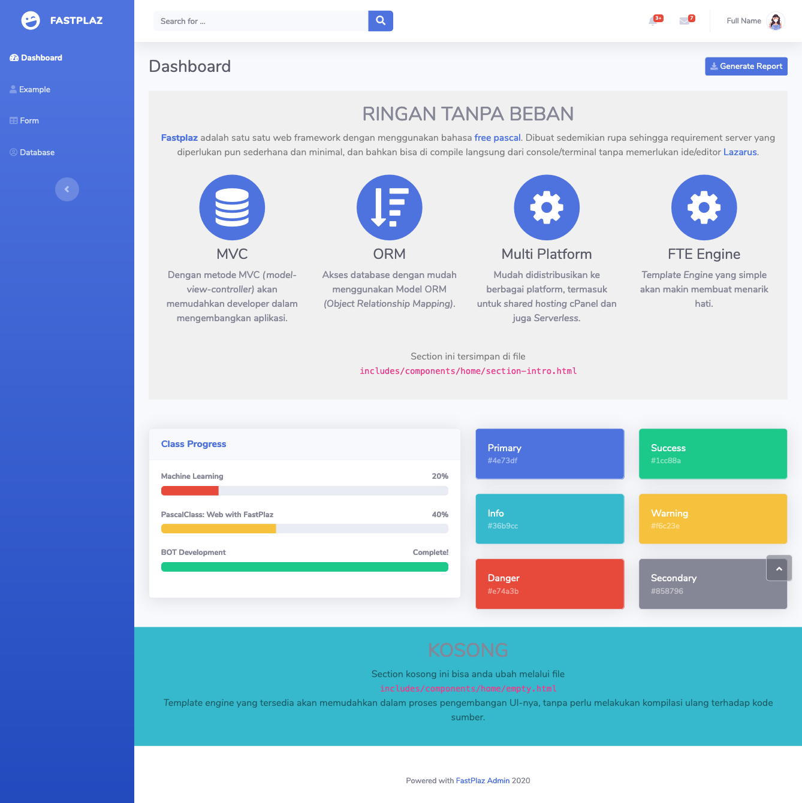
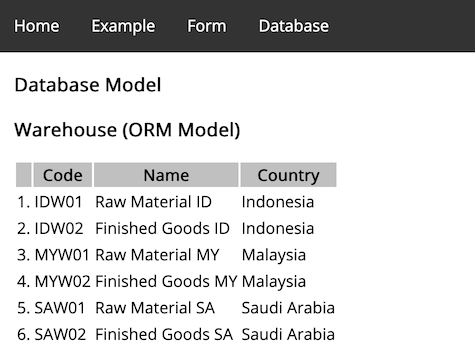
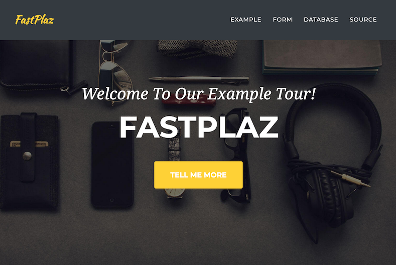
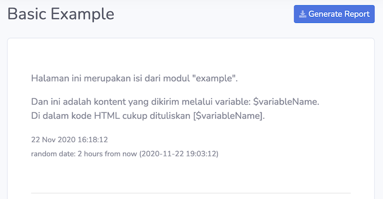
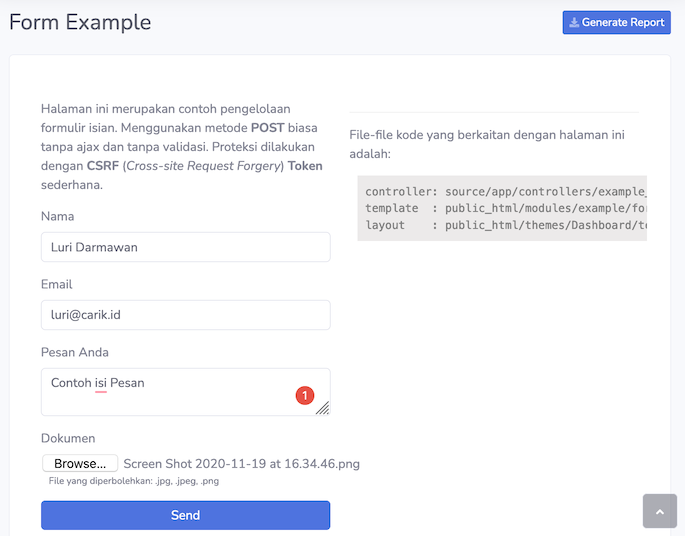
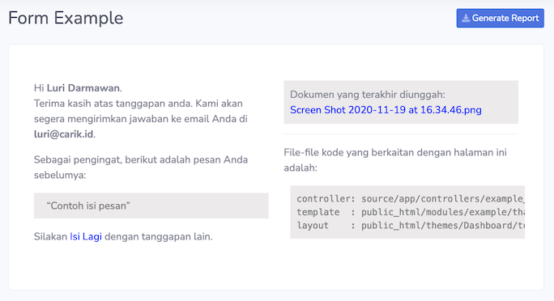
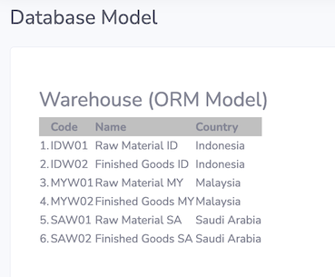
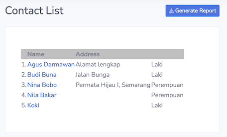
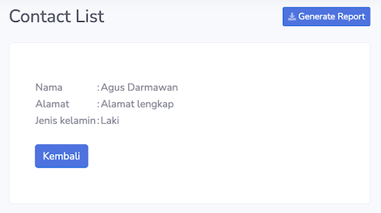

You can get this example through the [Create Full Package Application](/docs/usage#full-package-application) tool in the `FastPlaz|Create Full Package Application` menu'

_Using theme: Dashboard_

## Source Code

The source code ships with FastPlaz, through the [Create Full Package Application](/docs/usage#full-package-application) tool in the `FastPlaz|Create Full Package Application` menu'

## Topics

From this example you can learn about:

- [Template Engine](/docs/fte) with multiple _Themes_ and [Tags](/docs/fte#tag)
    
    - Displaying a [Flash Message](/docs/fte#special-tags) when there is an error.
    - Using `foreach` and the `if` conditional
- Form Handling

  With validation and simple protection using CSRF.
- File Upload
  
  With permissions for which file types may be uploaded.
- Session 
- Database access using [ORM (Object Relationship Mapping)](/docs/orm)

  - Displaying data as a list
  - Data details
  - _Joining_ other tables

## Screenshot

### Theme: Basic

### Theme: Simple

### Basic Example

### Form Handling

#### Success Submit

### Database Access with ORM

Displaying warehouse data

Displaying _Contacts_ data as a _list_ and _detail_, including use of the `if` tag as a conditional when displaying data.

### Login Page

#### Success Login

> Some links are intentionally hidden for classroom exercises. You can change them directly in the _source_.
