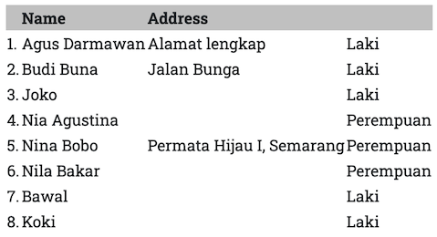

**FTE (FastPlaz Template Engine)** is a simple _template engine_ written in Pascal for use with [FastPlaz](https://fastplaz.com). FTE dynamically **separates** **business logic** (Pascal code) from **presentation logic** (_view_) by allowing special _tags_ to be placed inside an HTML document.

**FTE** can also _cache_ and apply simple compression to HTML documents.

Because **FTE** separates business logic from presentation logic, it is easier to split roles between the _Developer_ and the _UI Engineer_. The _UI Engineer_ can do their work without being directly involved in writing the business logic (Pascal), and vice versa.

## Theme

**FTE** lets _developers_ freely create various **themes** for their applications. FTE recommends the following directory and file structure.

```bash
├── public_html
│   ├── config
│   ├── files
│   │   └── images
│   ├── modules
│   │   ├── contacts    👈 presenter/view for the Contact module
│   │   └── employees   👈 presenter/view for the Employee module
│   ├── themes
|   |   ├── ThemeCantik 👈 ThemeCantik theme
|   |   ├── Dashboard   👈 Dashboard theme
│   │   └── simple      👈 Simple theme
│   │       ├── assets
│   │       ├── plugins
│   │       └── templates
│   └── ztemp
```
The default theme is selected in the `config.json` configuration file.

```json
{
  "systems" : {

    "theme_enable" : true,
    "theme" : "Dashboard",  👈 select the theme here

  }
}
```

Example of the HTML `master` layout in the `Basic` theme.
```html
<!DOCTYPE html>
<html>
[include file="includes/head"]
<body id="page-top">
    [include file="includes/navigation"]
    <div id="main">
        <div class="container">
            <h3>[$Title filter=ucwords]</h3>
        </div>
        [maincontent]
    </div>
    [include file="includes/footer"]
</body>
</html>
```

It looks very simple thanks to `Tagging`.
You can study the details from the example files available in the [repository](https://github.com/fastplaz/fastplaz/tree/master/tools/templates/packages/Simple/public_html/themes/Basic).

## Tag

**FTE** can process HTML using specific `Tag` codes.

### Construct Tags

Some of the constructs available in FTE

| Tag  | Description |
|---|---|
| [include](/docs/fte#include) | Inserts an .html file into the html document<br>`[include file="includes/head"]` |
| [foreach](/docs/fte#foreach) | Loop for displaying data from a table, array or json |
| [if](/docs/fte#foreach) | Conditional |
| filter | Applies a _filter_ to a variable. Currently available: nl2br, uppercase, lowercase, ucwords, moreless, dateformathuman, permalink, multifilter.<br>example: `[$FullName filter=uppercase]` |
| assign | Assigns a value to a variable |
| assignto | Assigns the value of a table field to a variable |
| block | block controller |

### Special Tags

With several special **[tags]** such as:

| Tag  | Description |
|---|---|
| title | Displays the `sitename` from config.json |
| slogan | Displays the `slogan` from config.json |
| baseurl | Displays the `baseurl` from config.json |
| thisurl | Current active URL |
| theme | Name of the current theme|
| themepath | Path of the current theme |
| themefullpath | Full path, including the BaseURL, of the current theme.<br>`<link rel="stylesheet" href="[themefullpath]/styles/style.css">` |
| datetime | Displays the date and time, with the default format 'dd MMM YYYY HH:nn:ss'. Use the 'format' parameter to control the output.<br>Example:`[date format="yyyy/dd"]` |
| time | Displays the time |
| date | Displays the date, with the default format 'dd MMM YYYY'. Use the 'format' parameter to control the output.<br>Example:`[date format="yyyy/dd"]` |
| env | Gets the value of an environment variable,<br> e.g.: `[env key="HTTP_REFERER"]`
|
| loadtime | Displays the application processing time in milliseconds |
| flashmessages | Displays Flash Messages, can be used to store error messages |
| maincontent | Location where each module's main content is displayed |


### Featured Tag

And several _featured tags_:

| Tag  | Description |
|---|---|
| recaptcha | Displays [ReCaptcha](https://www.google.com/recaptcha/about/) to better secure your forms.<br>`[recaptcha key="your_public_key"]`|
| csrf-token | CSRF Token as a simple measure to secure forms.<br>`[csrf-token name="optionalModuleName"]` |
| gt | GetText, Multi language support.<br>`[gt text="Welcome"]` |


## Usage Examples

More complete examples of using these `tags` can be found in the provided _examples_, especially in the output generated by the _Full Package Application_ wizard.

### include

`include` inserts an .html file into the document. The file location is relative to the directory of the theme currently in use.

If the `Dashboard` theme is in use and the tag `[include file="includes/head"]` is found, the file will resolve to `themes/Dashboard/templates/includes/head.html`.

```html
<!DOCTYPE html>
<html>
[include file="includes/head"]
<body id="page-top">
    [include file="includes/navigation"]
    <div id="main">
        <div class="container">
            <h3>[$Title filter=ucwords]</h3>
        </div>
        [maincontent]
    </div>
    [include file="includes/footer"]
</body>
</html>
```


### foreach

`foreach` is a loop used to display the contents of data of type table, array or json.

`foreach` usage format
```bash
[foreach from=$VariableName item=row type=table]
  
  html content: [row.nama_field]

[/foreach from=$VariableName]
```

`$VariableName` is defined in your controller code.
```pascal
ThemeUtil.AssignVar['$VariableName'] := @Model.Data;
```

The following HTML code also shows how to use `if` inside a `foreach` block.

```bash
<table>
  <thead>
    <tr><th>&nbsp;</th><th>Name</th><th>Address</th><th></th></tr>
  </thead>
  <tbody>
    [foreach from=$Contacts item=aItem type=table]
      [aItem.sex assignto=$JK]
      <tr><td>[$index].</td><td>[aItem.first_name] [aItem.last_name]</td><td>[aItem.address]</td><td>[if $JK eq "0"]Laki[else]Perempuan[/if]</td></tr>
    [/foreach from=$Contacts]
  </tbody>
</table>
```
Result:


### assignto

`assignto` assigns the value of a table field to a variable. This is usually useful when you need a condition on that field.

If the `contacts` table has a `sex` field containing 0 or 1, meaning male or female, the html code would look like this:

```bash
[foreach from=$Contacts item=aItem type=table]
  [aItem.sex assignto=$JK]
  <tr><td>[$index].</td><td>[aItem.first_name] [aItem.last_name]</td><td>[aItem.address]</td><td>[if $JK eq "0"]Laki[else]Perempuan[/if]</td></tr>
[/foreach from=$Contacts]
```

---

//TODO: Assign
