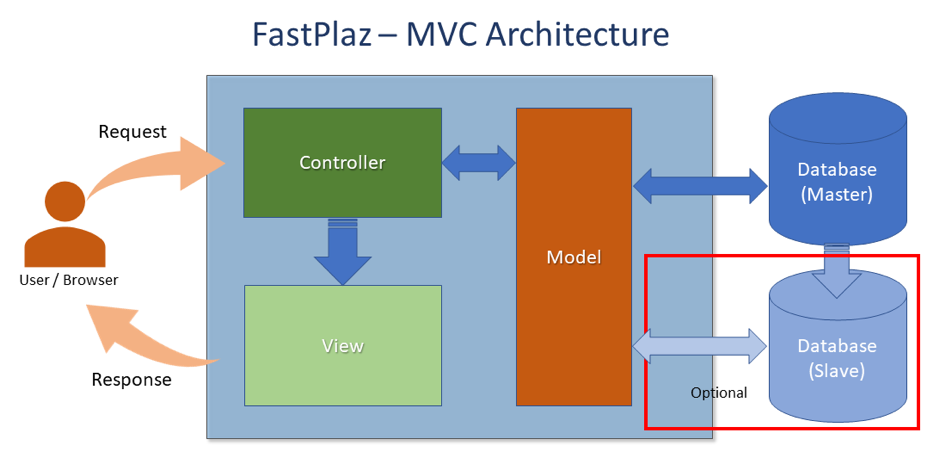

The basic concept of the FastPlaz architecture is actually very simple: separate the routines that execute, the ones that process data, and the ones that present it. This is commonly known as MVC _(Model-View-Controller)_. 

This concept is very common in web and mobile application frameworks. 
Many web application frameworks (including PHP, Django, Ruby on Rails, etc.) use MVC as their software architecture.

## MVC 



### Model

Defines the data for the application (usually stored in a database server).

### View

Produces the interaction visible to the user (usually a web page). The View component presents information to the user and sends actions to the Controller for data manipulation.

### Controller

Basically, the interface between the View and the Model. It processes actions given by the user, processes data from the database, and sends the result to the View to be shown on the user's screen.


One of the main advantages of the MVC architecture is the abstraction between these three components. 

## Files and Directories

### Structure

By default, a project created with FastPlaz has the following directory structure:

```bash
├── docs
├── public_html
│   ├── config
│   ├── files
│   │   └── images
│   ├── modules
│   │   ├── contacts
│   │   └── employees
│   ├── themes
│   │   └── simple
│   │       ├── assets
│   │       ├── plugins
│   │       └── templates
│   └── ztemp
└── source
    ├── api
    │   ├── controllers
    │   └── routes
    ├── app
    │   ├── controllers
    │   └── routes
    ├── common
    │   ├── controllers
    │   └── models
    └── sql
```

All Pascal source can be placed in the `source` directory. It is recommended to group the files by function. Each _project_ usually needs at least the `controller`, `route`, and `model` directories.

The contents of the `public_html` folder are the files you can publish/upload to the target server.

### Configuration

The configuration file is `config/config.json`, with the following structure:

```json
{
  "systems" : {
    "sitename" : "FastPlaz Example",
    "slogan" : "FastPlaz App Example",
    "baseurl" : "",
    "admin_email" : "webmaster@coba.com",
    "development" : true,
    "debug" : true,
    "module_default" : "main",
    "language_default" : "id",
    "theme_enable" : true,
    "theme" : "Dashboard",
    "cache" : "none",
    "temp" : "ztemp",
    "error_url" : "\/",
    "session_timeout" : 0,
    "error_redirect" : false
  },
  "database" : {
    "default" : {
      "driver" : "MySQL 5.7",
      "hostname" : "localhost",
      "port" : "",
      "username" : "your_username",
      "password" : "your_password",
      "database_name" : "the_database_name",
      "charset" : "",
      "prefix" : "",
      "version_check": false,
      "library" : ""
    }
  },
  "mailer" : {
    "default" : {
      "hostname" : "your.smtp.server",
      "username" : "your_username",
      "password" : "the_password",
      "smtp_port" : "465",
      "ssl" : true,
      "tls" : true
    }
  }
}
```

Notes:

- `session_timeout` is measured in **minutes**. See [Upgrading to the 2026 Release](/docs/upgrade#session-timeout-is-in-minutes).
- To run the application as a standalone HTTP server (port, `max_requests`, database connection, `trust_proxy`), add a `systems/server` section. See [Standalone HTTP & CGI](/docs/standalone#configuration).
