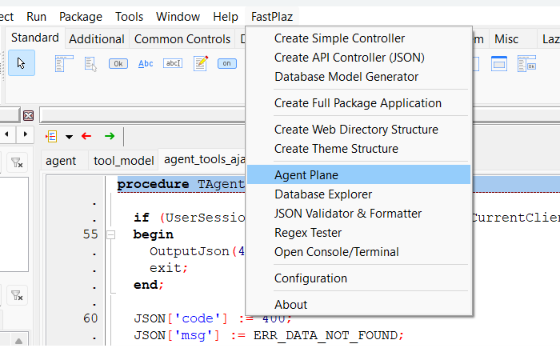
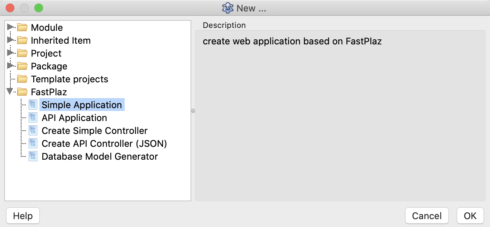

## Prerequisite

* [FPC](https://www.freepascal.org/) / [Free Pascal Compiler](https://www.freepascal.org/), version 3.2.2
* [Lazarus](https://www.lazarus-ide.org/) (optional; applications can also be _compiled_ from the terminal)
* [Git Client](https://www.git-scm.com/)
* Web Server (Apache), optional. Since the 2026 release, applications can run as a [standalone HTTP server](/docs/standalone)
* Database Server (MySQL, PostgreSQL, SQLite, or Firebird), if the application uses a database

## Preparation

### Download / Clone

First, download or clone this repository.

```bash
$ git clone -b development https://github.com/fastplaz/fastplaz.git
```

Cloning is recommended over a manual download. When there are updates or changes later, you only need to `pull`.

```bash
$ git reset --hard HEAD
$ git pull
```

This way only the changes are fetched, without re-downloading all the files. After that, just recompile the package files.

### Installation

If you are a [Lazarus](https://www.lazarus-ide.org/) user, installing FastPlaz for basic use is very easy. Just follow these steps:

1. Install `jcfbase` and `jcfidelazarus` (Jedi Code Format) from the **Online Package Manager**.
2. Open `tools/fastplaz_runtime.lpk`, then compile it.
3. Open `tools/fastplaz_tools.lpk`, then compile and install it. Lazarus will be _rebuilt_.

As a result, a **FastPlaz** menu like this will appear, including [AI Agent Plane](/docs/ai-agent-plane), Database Explorer, and other tools.



And new options will appear in the `File|New Project ...` menu, like this



## Running Your First Project

1. Select **File → New Project ... → Simple Application** (or **API Application**).
2. Select the HTTP **Run Mode**.
3. Run the project (**Run → Run** or F9), then open [http://127.0.0.1:17845](http://127.0.0.1:17845).

The same binary can also run as CGI when executed by Apache. See [Standalone HTTP & CGI](/docs/standalone).

## Web Server Configuration

This section is for running the application as **CGI** under Apache, for example on shared hosting. For standalone mode behind nginx/Apache, see [Standalone HTTP & CGI](/docs/standalone#reverse-proxy).

### CGI and mod_rewrite

In CGI mode, FastPlaz uses the **CGI** protocol to run, which means the web server must have CGI enabled. Don't worry, most Apache web server distributions already have CGI enabled.

For more power, FastPlaz strongly recommends enabling `Rewrite` in Apache. To enable `mod_rewrite`, just remove the comment mark in the `httpd.conf` file.
```
#LoadModule request_module modules/mod_request.so
#LoadModule reqtimeout_module modules/mod_reqtimeout.so
LoadModule rewrite_module modules/mod_rewrite.so
#LoadModule sed_module modules/mod_sed.so
#LoadModule session_module modules/mod_session.so
```

### Virtual Host

CGI can be enabled by changing the _virtual host_ configuration. An example looks roughly like this:
```bash

<VirtualHost *:80>
    ServerName course.fastplaz.com
    DocumentRoot "D:\course\fastplaz\public_html"
    ErrorLog "logs/course.fastplaz.com-error.log"
    CustomLog "logs/course.fastplaz.com-access.log" common

    <Directory "D:\course\fastplaz\public_html">
        Options +ExecCGI +Indexes
        AddHandler cgi-script .cgi
        AddHandler cgi-script .bin
        AddHandler cgi-script .exe
        Require all granted
        AllowOverride All
    </Directory>
</VirtualHost>
```

Add `Options +ExecCGI` and `AddHandler` as shown above. The same applies to Apache users on Linux or Mac; only the Directory and DocumentRoot path names differ.
