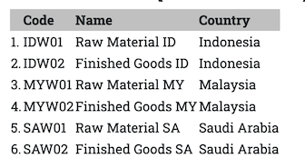
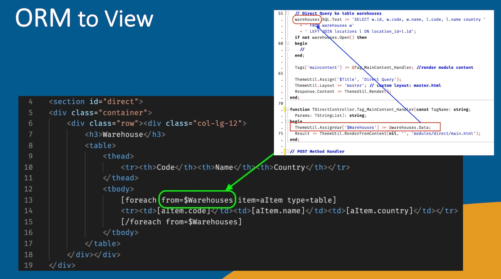

_Object Relationship Mapping_ is a programming technique for using a relational database as data storage in the form of objects. It is commonly used in object-oriented programming languages that need a relational database for storage.
 
FastPlaz provides a *Simple ORM* for this, especially for simple CRUD use.

The supported databases are the ones supported by Free Pascal:
- Firebird
- MySQL
- ODBC
- Oracle
- PostgreSQL
- SQLite3

The database is selected through the [configuration](/docs/architecture#configuration) in `config.json`.

## Model

The first step in connecting an application to a database is to create a `Model`.

Suppose there is a table named `contacts`; the FastPlaz model source code would look like this.

```pascal
 TContactModel = class(TSimpleModel)
 private
 public
   constructor Create(const DefaultTableName: string = '');
 end;

.
.
.

constructor TContactModel.Create(const DefaultTableName: string = '');
begin
  inherited Create( DefaultTableName); // table name = contacts
  //inherited Create('yourtablename'); // if use custom tablename
end;

```

### Default Table Name

FastPlaz models use _Plural Methods_. This means:

- TContactModel 👉 table name:  contacts
- TBuildingModel 👉 table name:  buildings
- TWarehouseModel 👉 table name:  warehouses

So `TKaryawanModel` will refer to the table `karyawans`? Yes, that's right. Looks odd? Don't worry, there is a feature for [customizing the name](/docs/orm#custom-naming).

### Default Primary Key

The default primary key is the first letter of the table name followed by the string 'id'.

So if the model name is `TContactModel`, then:
- Table name: contacts
- Primary key: cid


### Custom Naming

You can change the default table name and `primaryKey` to suit your needs.

```pascal
constructor TKaryawanModel.Create(const DefaultTableName: string = '');
begin
  inherited Create( DefaultTableName);
  TableName := 'karyawan'; // define the table name here
  primaryKey := 'id';
end;

```

## CRUD

As with any application connected to a database, you will inevitably deal with *CRUD* _(Create Read Update Delete)_.

### Create

To create new data, call the `New` _procedure_, then assign values to the fields, using the format:

```pascal
contact['field_name'] := 'value';
```
So it looks like this:

```pascal
// create new data

contact := TContactModel.Create();
contact.New;
contact['field_name'] := 'value';
contact['first_name'] := 'Luri';
contact['last_name'] := 'Luri';
contact['address'] := 'Alamat Lengkap Saya';
contact['status_id'] := 0;
if not contact.Save() then
begin
  //
  // failed to save the data
  //
end;
contact.Free;
```

### Read

A field value can be read using the following format:
```pascal
variableName := contact['field_name'];
```

Available functions/methods:
- All, gets all rows
- Find(...), gets data matching certain conditions
- FindFirst(...), gets the *first* row matching certain conditions.

```pascal
// get all rows
contact := TContactModel.Create();
if contact.All then
begin
  //
  // data found
  //
end;
```

```pascal
// find data where primaryKey field = 2
if contact.Find(2) then
begin

  // data found
  firstName := contact['first_name'];

end;
```

```pascal
// find data with conditions
var
  whereAsArray: TStringArray;

.
. 
whereAsArray.Add('first_name="luri"');
if contact.Find(whereAsArray) then
begin
  //
  // data found
  //
end;
```


```pascal
// find data with conditions, order and limit
// order by name
// limit 10 offset 90
var
  fieldList: string;
  whereAsArray: TStringArray;

.
. 
whereAsArray.Add('first_name="luri"');
fieldList := 'cid, name, address, status';
if contact.Find(whereAsArray, 'name', 10, fieldList, 90) then
begin
  //
  // data found
  //
end;
```


#### Join Table

Joining other tables is easy too. Add the following code before the find call.

```pascal
contact.AddJoin('reference_table', 'reference_field', 'join_field', 
  ['field_name1','field_name2 alias_name']);
```

A complete example looks like this:

```pascal
// condition & join

whereAsArray.Add('first_name="luri”');

contact.AddJoin('locations', 'id', 'contacts.location_id', 
  ['code','name country']);

if contact.Find(whereAsArray) then
begin
  //
  // data found
  //
end;
```

### Update

Updating data is similar to [Create](/docs/orm#create).
Start by finding the data, then change it as in the following code:

```pascal

// find and update
// find the contact with primary key = 6

if contact.Find(6) then
begin
  s := contact['first_name'];

  contact['first_name'] := 'Budi';// change the name to "Budi"
  if contact.Update() then
  begin

    // update succeeded

  end;

end;
```

### Delete

```pascal
// delete with index

if contact.Delete(6) then
begin
  //
end;

```

```pascal
// delete with condition
var
  whereAsArray: TStringArray;

.
.

whereAsArray.Add('status_id=1');
if contact.Delete(whereAsArray) then
begin
  //
end;

```

```pascal
// delete with Find function
var
  whereAsArray: TStringArray;

.
.

whereAsArray.Add('status_id=1');
if contact.FindFirst(whereAsArray) then
begin
  // do something

  Delete();
end;

```


## Query Builder

One of the nice things about the FastPlaz Simple ORM is its Query Builder. The Query Builder generates an SQL (MySQL) statement, which is then executed.

```pascal
// query builder

contact := TContactModel.Create();
if contact.Select('first_name')
  .Where('status_id=0')
  .OrderBy('first_name')
  .Limit(10)
  .Open() then
begin

  //

end;
```

Behind the scenes, this code generates the following _SQL Query_:
```sql
SELECT first_name 
FROM contacts 
WHERE status_id=0 
ORDER BY first_name 
LIMIT 10
```

## Processing Data

The sections above show how to write and read a _single row of data_. What if you need to process data containing multiple records? You can use Pascal's loop constructs, such as `for...do`, `repeat...until` or `while...do`.

```pascal
for i := 1 to contact.RecordCount do
begin
  firstName := contact['first_name'];

  // your code here

  contact.Next; // move to the next record
end;
```
```pascal
repeat
  firstName := contact['first_name'];

  // your code here

  contact.Next; // move to the next record
until warehouses.EOF;
```
```pascal
while not contact.EOF do
begin
  firstName := contact['first_name'];

  // your code here

  contact.Next; // move to the next record
end;
```

The code above is useful when you process data inside a `controller`.

## Displaying Data

[Processing Data](/docs/orm#processing-data) is not always necessary if you only want to display the data to the user. With [FTE/FastPlaz Template Engine](/docs/fte), you only need to define the data variable to be sent to the `view`.

For example, if an application needs to display the contents of the `warehouses` table, you would do the following:

### Write Pascal code to access the warehouse model

```pascal
// code in the warehouse controller
// the following line is defined in the Create procedure
//   warehouses := TWarehouseModel.Create();  

procedure TWarehouseController.Get;
var
  whereAsArray: TStringArray;
begin
  DataBaseInit(); // initialize the database connection

  warehouses.AddJoin('locations', 'id', 
    'warehouses.location_id', 
    ['code','name country']);
  if not warehouses.Find(whereAsArray) then
  begin
    //
  end;

  // Assign the warehouses data to the $Warehouses variable
  //   for use in the view
  ThemeUtil.AssignVar['$Warehouses'] := @warehouses.Data;

  Tags['maincontent'] := @Tag_MainContent_Handler; //<<-- tag maincontent handler
  ThemeUtil.Assign('$Title', 'DB Model');
  ThemeUtil.Layout := 'master'; // custom layout: master.html
  Response.Content := ThemeUtil.Render();
end;
```

### HTML code in the view

The HTML code in the view is as simple as this:

```html
<table>
    <thead>
        <tr><th>&nbsp;</th><th>Code</th><th>Name</th><th>Country</th></tr>
    </thead>
    <tbody>
        [foreach from=$Warehouses item=aItem type=table]
        <tr><td>[$index].</td><td>[aItem.code]</td><td>[aItem.name]</td><td>[aItem.country]</td></tr>
        [/foreach from=$Warehouses]
    </tbody>
</table>
```

Information about the `foreach` tag can be found in the [FTE](/docs/fte#foreach) section.

The result will look roughly like this


This is a simple example using only "&lt;table&gt;..&lt;/table&gt;". For a nicer presentation, you can use Ajax with existing JS/CSS libraries.

A more complex example can be found in the source code of the [Database-Example](https://github.com/pascal-id/database-with-fastplaz) repository.

More about _templating_ can be found in the [FastPlaz Templating Engine](/docs/fte) section.

### Illustration


