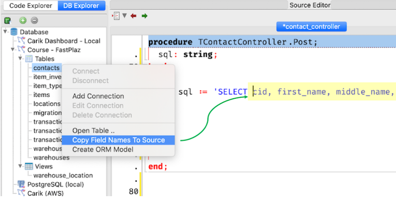
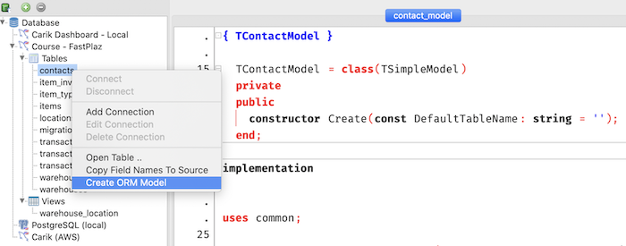

The **Database Explorer** utility is very handy for those who don't want to keep switching windows from the IDE/Editor to a DB browser, back to the editor, and then back again.

The **Database Explorer** utility is very useful for managing databases. It covers simple needs such as `select`, viewing tables, and so on.

<video controls width="720px">
  <source src="https://github.com/fastplaz/fastplaz.github.io/raw/master/videos/db-explorer-intro.mp4" type="video/mp4">
  Your browser does not support the video tag.
</video>

Following the [SQLdb](https://wiki.freepascal.org/SQLdb_Tutorial1) support in free-pascal, **Database Explorer** supports connections to these databases: MySQL, Firebird, ODBC, Oracle, PostgreSQL, SQLite3.

## Features

### Copy fields name to source editor

A common problem for _developers_ is forgetting which fields a table has, and having to switch back and forth between a database explorer application (e.g. phpmyadmin) and Lazarus to retype the table's field names into the source code.

Well... this _tool_ makes that easy. Right-click a table name in the list, and this menu will appear.

The table's field names will then be written into the source code editor, and are also available on the _clipboard_.

### Auto generate model

Besides the FastPlaz main menu, [creating a model](/docs/usage-model#creating-a-model) can also be done from Database Explorer. Just right-click a table name, then choose the `Create ORM Table` menu.

