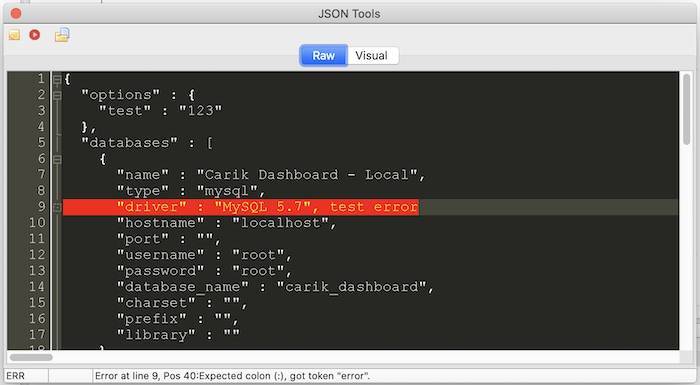
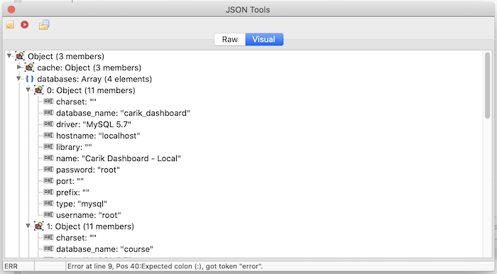

The **JSON Validator** feature is very useful for developers who often build or consume **APIs**: it checks whether a JSON structure is valid and also _formats_ it.

## Validator & Formatter

## Visualization

