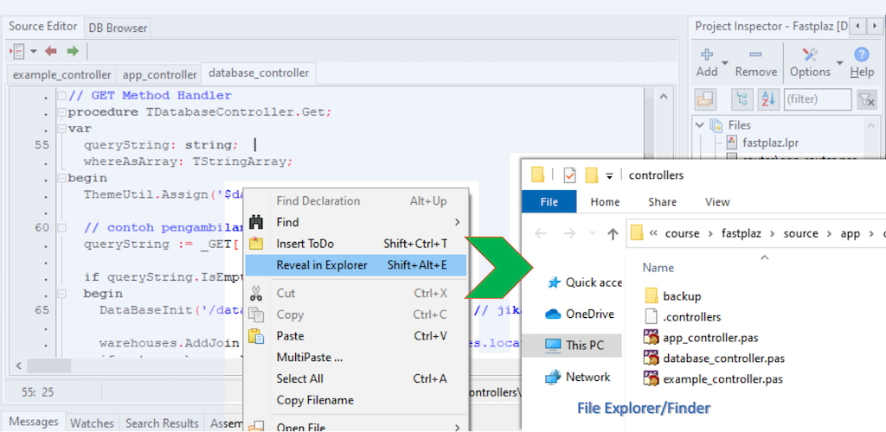

Ever had to switch back and forth between Lazarus and _Explorer_ (Finder on MAC), not to mention opening _File Explorer_ from scratch, then finding and opening the path/folder? Some developers create temporary _shortcuts_ for this, just to make it easier.

With [FastPlaz](https://fastplaz.com) this is easy. Right-click in the source code editor and you will find the `Reveal in Explorer` menu. _File Explorer_ opens automatically once this menu is selected and goes straight to the directory/path where the file is located.

Exploring your project is now right at your fingertips.

