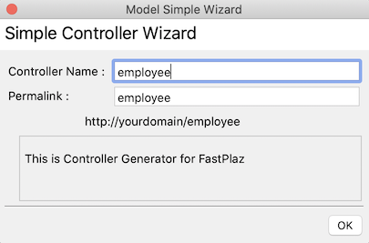

## Naming

Before reading this page, make sure you have studied the [controller naming convention](/docs/usage#naming) in FastPlaz.

```note
url: http://localhost/employee
tabel: employees
file controller : employee_controller.pas
file model      : employee_model.pas
```

## Creating a Controller

A controller can be created in 2 ways:
1. From the `File|New ...|Create Simple Controller` menu
2. From the `FastPlaz|Create Simple Controller` menu

In this dialog

enter the controller's function name. The controller name will match the permalink/url that will be used.

A file `employee_controller.pas` will then be created, roughly like this.

```pascal
unit employee_controller;

{$mode objfpc}{$H+}

interface

uses
  Classes, SysUtils, html_lib, fastplaz_app, fpjson, json_lib, HTTPDefs, 
    fastplaz_handler, database_lib, string_helpers, dateutils, datetime_helpers;

type
  TEmployeeController = class(TMyCustomController)
  private
    function Tag_MainContent_Handler(const TagName: string; Params: TStringList
      ): string;
    procedure BeforeRequestHandler(Sender: TObject; ARequest: TRequest);
  public
    constructor CreateNew(AOwner: TComponent; CreateMode: integer); override;
    destructor Destroy; override;

    procedure Get; override;
    procedure Post; override;
  end;

implementation

uses theme_controller, common;

constructor TEmployeeController.CreateNew(AOwner: TComponent; 
  CreateMode: integer);
begin
  inherited CreateNew(AOwner, CreateMode);
  BeforeRequest := @BeforeRequestHandler;
end;

destructor TEmployeeController.Destroy;
begin
  inherited Destroy;
end;

// Init First
procedure TEmployeeController.BeforeRequestHandler(Sender: TObject; 
  ARequest: TRequest);
begin
end;

// GET Method Handler
procedure TEmployeeController.Get;
begin
  Tags['maincontent'] := @Tag_MainContent_Handler; //<<-- tag maincontent handler
  Response.Content := ThemeUtil.Render();
end;

// POST Method Handler
procedure TEmployeeController.Post;
begin
  Response.Content := 'This is POST Method';
end;

function TEmployeeController.Tag_MainContent_Handler(const TagName: string; 
  Params: TStringList): string;
begin

  // your code here
  Result:=h3('Hello "Employee" Module ... FastPlaz !');

end;


initialization
  // -> http://yourdomainname/employee
  // The following line should be moved to a file "routes.pas"
  Route[ 'employee'] := TEmployeeController;

end.
```

This `unit` already handles the http GET and POST methods.

You can move the route in the `initialization` section to the `routes.pas` file.
