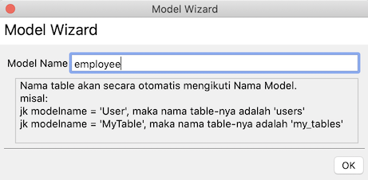

## Naming

Before reading this page, make sure you have studied the [model naming convention](/docs/orm#default-table-name) in FastPlaz.

```note
tabel      : employees
file model : employee_model.pas
```

## Creating a Model

A model can be created in 2 ways:
1. From the `File|New ...|Database Model Generator` menu
2. From the `FastPlaz|Database Model Generator` menu

In this dialog

enter the name of the model to create. Pay attention to the model naming convention and how it relates to the primary key.

A file `employee_model.pas` will then be created, roughly like this.

```pascal
unit employee_model;

{$mode objfpc}{$H+}

interface

uses
  Classes, SysUtils, fpjson, database_lib, string_helpers, dateutils,
  datetime_helpers, array_helpers;

type

{ TEmployeeModel }

  TEmployeeModel = class(TSimpleModel)
  private
  public
    constructor Create(const DefaultTableName: string = '');
  end;

implementation


uses common;

constructor TEmployeeModel.Create(const DefaultTableName: string = '');
begin
  inherited Create( DefaultTableName); // table name = employees
  //inherited Create('yourtablename'); // if use custom tablename
end;

end.
```

If your table name and primary key are different, define them as described in the [custom ORM convention](/docs/orm#custom-naming).

```pascal
constructor TEmployeeModel.Create(const DefaultTableName: string = '');
begin
  inherited Create( DefaultTableName);
  TableName := 'karyawan'; // define the table name here
  primaryKey := 'id';
end;

```
