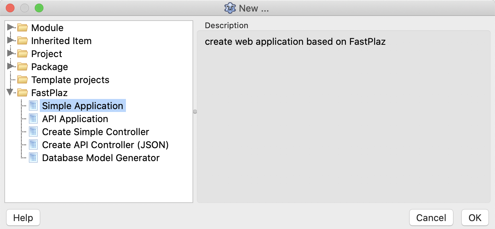
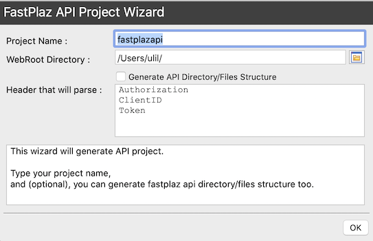
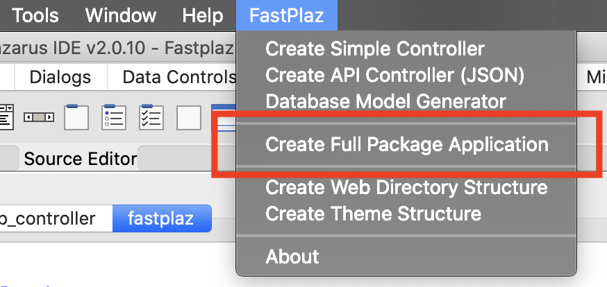
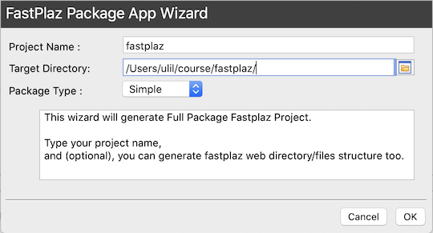
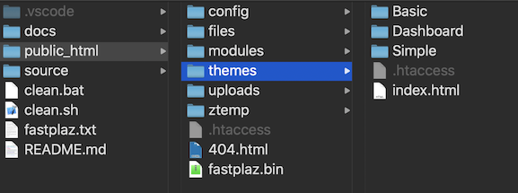
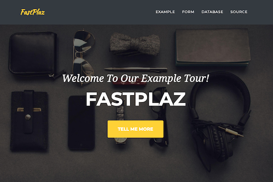

## Prerequisite

Make sure the [prerequisites](/docs/installation#prerequisite) in the [installation](/docs/installation#prerequisite) section are met.

## Structure

By default, a project created with FastPlaz has the following directory structure:

```bash
├── docs
├── public_html
└── source
    ├── api
    │   ├── controllers
    │   └── routes
    ├── app
    │   ├── controllers
    │   └── routes
    ├── common
    │   ├── controllers
    │   └── models
    └── sql
```

It is recommended to keep controllers, models and routes separate.

Below is an example _project_ structure of an application _generated_ with the [Full Package Application](/docs/usage#full-package-application) feature.

```bash
.
├── app
│   ├── build.sh
│   ├── clean.sh
│   ├── controllers
│   │   ├── app_controller.pas
│   │   ├── database_controller.pas
│   │   ├── example_controller.pas
│   │   └── example_form_controller.pas
│   ├── extra.cfg
│   ├── fastplaz.lpi
│   ├── fastplaz.lpr
│   ├── fastplaz.lps
│   └── routes
│       └── app_routes.pas
├── common
│   ├── controllers
│   └── models
│       ├── db_model.pas
│       └── warehouse_model.pas
└── sql
    └── db.sql
```

Note also that the file names are consistent and easy to read.

### Naming

FastPlaz recommends a standard naming scheme for the unit files in a project. Each file name starts with its 'task name', followed by its role (_controller, _model, _route). The task name should also match the `permalink` that will be used.

For example, to create a controller that handles the url `http://localhost/employee`, the controller unit file is named `employee_controller.pas`.

Likewise, for a model file that accesses the `employees` table, the model unit file is named `employee_model.pas`.

```note
url: http://localhost/employee
tabel: employees
file controller : employee_controller.pas
file model      : employee_model.pas
```

## Wizard

The Wizard is a FastPlaz feature that makes it easier for _engineers_ to build applications. With just a few clicks, the features you want are generated automatically.

### Simple and API Application

A new FastPlaz Project can be created from the `File|New Project ...` menu.



There are 2 options:

1. Simple Application
   Creates a simple FastPlaz-based application with a ready-made simple theme. This option helps developers who want to build a _custom project_.
2. API Application
   Building an API (_Application Programming Interface_) is easier with this option. It generates the project files along with a sample **JSON** output.

Next, a _dialog_ like this will appear:


Enter the _project_ name you need, and also the `webroot directory`, which is the directory the web server reads the website from.

Select the `generate structure` option if you want the application/api directory structure to be created automatically. This option is recommended for beginners.

If you are building an API that needs to parse parameters from the `Header`, enter the names of the header variables to use. APIs usually need headers such as `token`, `client-id`, `client-secret` and so on.


### Full Package Application

**Want to build a more complex and advanced application?** With database access and a choice of attractive _themes_? Use this option.



Then enter the _project_ name and the target directory where the application will be created.



The following directories and files will then be created


Ready-to-use _themes_ are provided:
1. Basic
2. Simple
3. Dashboard

If compilation succeeds, the page in the browser will look like this:


This template already includes sample code for
1. Form handling, with simple CSRF security.
   POST method and file upload.
2. Viewing data from a database.
   For database access using ajax (jsGrid), see the [Database Example](https://github.com/pascal-id/database-with-fastplaz) repo.
3. Reading variables from the _query string_.
4. Using Session.
5. Using a custom module layout.
6. Using a custom global layout for the **Home** page.
7. Assigning variables in the theme.
8. Flash Messages

FastPlaz also provides several tag variables you can use in your theme. Details are in the [FTE - FastPlaz Theme Engine](/docs/fte) section of this documentation.
